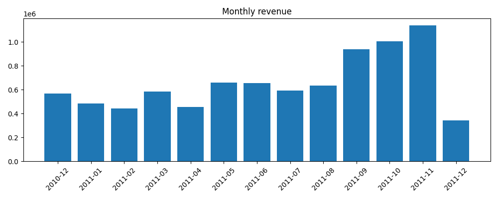

# Online Retail Customer Analysis

Analysis of one year of sales data from a UK online gift shop using Python and SQL.

## Questions
- How do sales change month by month?
- Which countries and products bring the most revenue?
- How many customers order only once?
- Which customers are the most valuable?

## Data
Online Retail dataset from the UCI Machine Learning Repository. 541,909 rows of sales from December 2010 to December 2011.

## What I did
1. Cleaned the data with pandas: removed duplicates, rows without a customer ID, cancelled orders, wrong quantities and prices, and postage rows.
2. Loaded the clean data into SQLite and answered the questions with SQL (GROUP BY, CTE, LAG, NTILE).
3. Grouped customers into 4 segments using RFM (Recency, Frequency, Monetary).
4. Made charts with matplotlib.

## Results
- About 26% of customers (Champions) bring about 68% of the revenue.
- 650 customers are "At risk": they used to order often but have stopped.
- About 35% of customers ordered only once.
- Sales are highest in October and November, before Christmas.
- Most revenue comes from the UK.

## Suggestions
1. Give loyalty offers to the Champions.
2. Send a special offer to the At risk customers.
3. Follow up with new customers after their first order.
4. Prepare stock early for the Christmas season.

## Files
- `online_retail_analysis.ipynb`: the full analysis
- `online_retail.csv.gz`: the data
